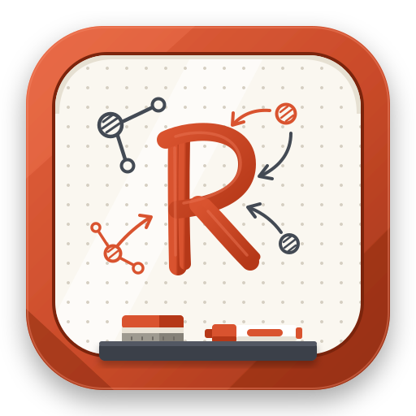

# Rustboard

<div align="center">
  
  <h3>A fast, pen-first digital whiteboard built with Rust and Tauri v2</h3>
</div>

---

> [!NOTE]
> **AI Disclaimer:** This project was developed by AI to create a fast, distraction-free, and reliable digital whiteboard tailored for my girlfriend's online teaching and tutoring sessions. It solves real-world pain points of mainstream whiteboard apps—sluggish web engines, subscription lock-in, unreliable touch/pen handling, and bloated feature sets—by focusing entirely on live screen sharing and seamless document workflows.

---

## Overview

**Rustboard** is a native, offline-first digital whiteboard designed specifically for **teaching, lecturing, and tutoring over shared screen sessions** (Zoom, Teams, Discord, Google Meet, etc.).

When teaching live, you need instant responsiveness, zero latency, reliable palm rejection, and clean export flows for students:
- **Organized Page Workflows**: Use **Frames** as virtual presentation slides or pages. When moving a frame, all sketches, writing, and diagrams inside move with it. Frames can be reordered at any time and exported directly into clean, multi-page vector PDFs for students after class.
- **True PDF Round-Trip**: Import existing PDF worksheets, exam problems, or presentation slides directly onto the canvas, write and annotate over them with stylus or mouse, and stamp your vector annotations directly back onto the original document without raster quality loss.
- **Offline & Lightweight**: Built with **Rust**, **Tauri v2**, and a hardware-accelerated 2D canvas. No cloud accounts, no sync lag, no telemetry overhead, and zero subscriptions.

---
## Screenshots


---
## Key Features

### 🖊️ Screen-Sharing & Teaching Tools
- **Pressure-Sensitive Stylus Inking**: Ultra-low-latency ink with smooth tapering powered by `perfect-freehand`.
- **Laser Pointer**: Cast live glowing pointer trails that automatically fade over time to guide student attention during screen sharing.
- **Interactive Ruler & Protractor**: On-screen hardware ruler with 1° / 5° precision angle adjustment via mouse wheel or two-finger touch, featuring automatic line snapping along the edge.

### 📄 Frame-Based Organization & PDF Export
- **Frame Pages**: Define canvas regions as presentation slides. Moving or resizing a frame automatically carries all contained strokes, shapes, and text.
- **Frame Re-ordering**: Rearrange pages in the Frame Navigator to set the exact sequence for multi-page export.
- **True Vector PDF & SVG Export**: Export all framed pages or the full canvas without quality loss or pixelation. When exporting the full board, frame boundary borders are automatically omitted for clean visuals.
- **Safe Frame Deletion**: Frames are protected against accidental erasure. Deleting a frame prompts whether to delete only the boundary or also its contained drawings.

### 📐 Shapes & Typography
- **Geometric Shapes**: Draw rectangles, 1:1 squares, ellipses, 1:1 circles, triangles, diamonds, and straight lines with a single click.
- **Arrows & Dashes**: Add arrowheads at the start, end, or both ends of lines, with solid, dashed, or dotted styling.
- **Typed Text Tool**: Place clean text blocks using standard cross-platform system fonts (`system-ui`). Includes in-place controls for **Bold**, **Italic**, font size scaling, and color palettes.

### 🔄 Manipulation & Selection
- **Anchor-Point Rotation**: Rotate any object, text, or multi-selection around an explicit pivot anchor (`⨁`) without unwanted warping or accidental scaling.
- **Quick Lasso Selection**: Click the Select tool or use the stylus barrel button / right-click to circle items with a freehand lasso loop.
- **Floating Actions**: Quick floating toolbar for Delete, Duplicate (`Ctrl+D`), Lock (`Ctrl+L`), and Text formatting.

### 💾 Safe Sessions & Zero Data Loss
- **Autosave Engine**: Continuous local state persistence keeps work safe even across accidental closures or power cuts.
- **Startup Chooser**: Choose between restoring your last whiteboard session or starting on a blank canvas.
- **Safe Exit Guard**: Warns before closing when unsaved changes exist, prompting for save or export.
- **Real-Time Minimap**: Positioned safely above zoom controls with an interactive red viewport indicator and live overview of all objects.

---

## Keyboard & Gesture Shortcuts

| Shortcut / Gesture | Action |
| --- | --- |
| **Pinch (2 fingers)** | Anchored zoom centered between your fingers |
| **Ctrl + Mouse Wheel** | Zoom canvas anchored to mouse cursor position |
| **Middle Click / Pan** | Drag to pan around the infinite canvas |
| **Stylus Barrel / Right-Click** | Quick lasso selection |
| **Ctrl + Z / Ctrl + Y** | Undo / Redo |
| **Ctrl + D** | Duplicate selected object(s) |
| **Ctrl + L** | Lock / unlock selected object(s) |
| **Delete / Backspace** | Delete selection |
| **Ctrl + V** | Paste image from clipboard |
| **Scroll on Ruler** | Rotate ruler angle (hold Shift for 5° increments) |

---

## Tech Stack

- **Desktop Framework**: [Tauri v2](https://v2.tauri.app/) (Rust backend + WebView2 runtime)
- **Frontend**: TypeScript, HTML5 Canvas 2D with sub-pixel rendering, Vite
- **PDF Engine**: `lopdf` (native Rust PDF manipulation) + `svg2pdf` (vector PDF compilation) + `pdfjs-dist` (client-side rendering)
- **Clipboard & Imaging**: `arboard`, `image`
- **Inking Algorithm**: `perfect-freehand`

---

## Building from Source

### Prerequisites

1. **Node.js** (v18 or newer) & `npm`
2. **Rust** toolchain (stable `x86_64-pc-windows-msvc` or `x86_64-pc-windows-gnu`)
3. **WebView2 Runtime** (pre-installed on Windows 10/11)

### Development

```bash
# 1. Install frontend dependencies
npm install

# 2. Run in development mode (hot-reload frontend & native shell)
npx tauri dev
```

### Production Build

```bash
# 1. Build frontend bundle
npm run build

# 2. Compile optimized release binary
npx tauri build --target x86_64-pc-windows-gnu --no-bundle
```

The compiled standalone executable will be located at:
```
src-tauri/target/x86_64-pc-windows-gnu/release/rustboard.exe
```

### Portable Deployment

Rustboard requires no installer or administrative privileges:
1. Place `Rustboard.exe` and `WebView2Loader.dll` in any folder or USB drive.
2. Launch `Rustboard.exe` directly.

---

## License

**Source Available** — This project is source available for personal viewing, inspection, and educational evaluation only. It is **not** licensed as open source software, and no license is granted for reproduction, distribution, modification, or commercial use. See [`LICENSE`](LICENSE) for full details.
